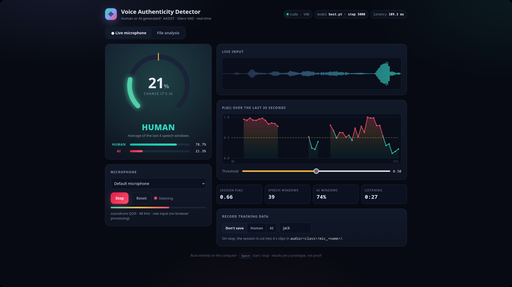

# AI voice detector (AASIST)

Tells whether a voice recording is a real human or AI-generated (TTS / voice conversion).



*The demo UI (`python server.py`, then http://127.0.0.1:8765) listening live through a
Bluetooth headset mic: the gauge shows the current verdict, the timeline every 0.5 s check.*

See **[REFERENCES.md](REFERENCES.md)** for every language, library, AI model and dataset (online and local) used, with versions, licenses and citations.

- **Model:** AASIST (Jung et al., ICASSP 2022), ~297K parameters, about 15 ms per 4 s window on an RTX 4050.
  Starts from the official ASVspoof2019-LA weights in `models/pretrained/` and is fine-tuned from there.
- **Classifier:** AASIST's own graph-attention back-end (spectral and temporal graphs plus a master node).
  It reads out a 160-d embedding, then one linear layer with a 2-way softmax gives P(human) and P(AI).
  Training uses class-weighted cross-entropy. The decision threshold on P(AI) is calibrated at the
  equal-error-rate point of your held-out recordings (Local validation). Checkpoints up to v2 used
  the pooled validation set instead, which put it too high (0.653); override it with `--threshold`.
  The default `models/checkpoints/best.pt` is **v5** (v3 -> v4 -> v5 fine-tunes, step 5000) with the
  threshold set to 0.45 by `compare.py`: the value with the best mean balanced accuracy over clean,
  noisy, mic, phone-replay, SONAR and DeepVoice tests (`threshold_trained` keeps the original 0.287,
  which flags too many replayed humans). Older models stay in `models/checkpoints/v2..v4/`; compare
  any of them with `python compare.py models/checkpoints/v4/best.pt models/checkpoints/v5/best.pt`.
- **Standard input format:** 16 kHz, mono, float32, leading/trailing silence trimmed, cut into
  64,600-sample (~4.04 s) windows, each RMS-normalised to -26 dBFS. Shorter clips are tiled to
  length. Long files are scanned with 50% overlap, near-silent windows are skipped, and the
  per-window P(AI) values are averaged.
- **Speech detector first:** Silero VAD (MIT, ~2 MB, `models/vad/`) marks which 32 ms frames contain
  speech. Windows with less than 30% speech are skipped, and a recording with under 0.5 s of speech
  gets the verdict **NO SPEECH** instead of human/AI, so silence and background noise are never forced
  into one of the two classes. `build_local_csv.py` uses the same check to keep no-speech clips out of training.
- **Background augmentation:** 40% of training clips, human and AI alike, get a background mixed in at
  0-30 dB: real noise recordings (`audio/human/yairamr/noise_only*` + anything in `noise/`), babble of
  2-4 other voices, or synthetic hiss/rumble. Without it the model learned "background noise = human".
  Put fan/room/game audio or music *without vocals* in `noise/` to add more. `train.py --bg-prob 0` turns it off.
- **Channel augmentation** (`detector/augment.py`), also on human and AI alike:
  - a phone/laptop loudspeaker (no bass, peaky mids) followed by a room on 15%;
  - room reverb on 35% of clips (synthetic room impulse responses);
  - a random speaker/mic frequency response, sometimes overdriven, on 30%;
  - MP3, Opus or Vorbis compression on 25%.

  This is for live microphone use. Reverb was v2's blind spot: a simulated room alone took its EER
  from 3% to 34%. `train.py --channel-aug 0` turns it off; `evaluate.py --channel` runs any test
  through all three effects.
- **Data:** streamed from the Hugging Face Hub (`SpeechAntiSpoofingBenchmarks/*`) and never saved
  to disk, capped at a **fixed pool of 50,000 clips** (24,100 human / 25,900 AI) listed in
  `data/online_subset.csv`. It is half of every batch; your recordings are the other half.
  - Train: ASVspoof5, In-the-Wild (80% of speakers), XMAD, CD-ADD, DFADD, EmoSpoofTTS, DeepVoice
    (5 of its 8 people). Quotas in `TRAIN_SOURCES` (config.py).
  - Validation: ASVspoof5 (last 10 shards), In-the-Wild (held-out 20% of speakers), your held-out
    recordings clean (Local) and through the simulated room/mic/codec (Local+mic)
  - Never trained on (generalisation tests): SONAR, and DeepVoice's Obama / Taylor / Margot

- **Your own recordings** (`audio/human/<folder>`, `audio/ai/<folder>`) are indexed by
  `build_local_csv.py` into `data/local_data.csv` and make up half of every batch (`LOCAL_WEIGHT` = `ONLINE_WEIGHT` = 1.0).
  Human and AI are sampled 50/50, and folders are weighted by sqrt(size) so small ones still count.
  Whole videos are held out for validation; single-recording folders hold out their last 20%.

## Demo UI (browser, live microphone)

```bash
python server.py               # then open http://127.0.0.1:8765
```

A local page (`web/index.html`, one file, works offline) talks to `server.py`, which runs the
model; it only listens on 127.0.0.1, so nothing leaves the machine.

- **Live microphone:** keeps the last ~4 s of mic audio and scores it every 0.5 s (about 70-100 ms
  per check on the GPU). The speech detector runs first, so silence shows LISTENING instead of a
  guess. The verdict is the mean P(AI) of the last 4 speech windows; the graph shows the last 30 s
  and the slider moves the threshold. The browser's own noise suppression, echo cancellation and
  auto-gain are switched off, because they rewrite the voice the way a denoiser does.
- **Record training data:** pick Human or AI before Start; on Stop the session is cut into 4 s
  clips in `audio/<class>/mic_<name>/` and kept whole in `data_collection/mic_sessions/`.
- **File analysis:** drop any audio/video file; shows the verdict and P(AI) per 4 s window.
- <kbd>Space</kbd> starts / stops.

It is a prototype: through a real mic it is far less reliable than on clean files until it has
been trained on recordings from that mic. `app.py` is the older desktop (Qt) version of the same.

Real replays help too: `python data_collection/record_replay.py --per-folder 30` plays clips
through the speakers while recording the mic (~70 min, can be stopped and resumed) into
`audio/<class>/replay/`.

## Android app (Voice Check)

`android/VoiceCheck.apk` runs the whole model **on the phone** (ONNX Runtime + AASIST ~1.6 MB +
Silero VAD ~1.3 MB). No server, no internet, nothing leaves the phone. Same look as the web UI:
gauge, HUMAN/AI bars, live waveform, P(AI)-over-30s timeline, threshold slider, stat tiles.

- **Check a recording:** share any voice note / recording to Voice Check from another app, or pick
  one in the app. Per-window P(AI) timeline + verdict.
- **Listen live:** uses the phone mic. Silence and non-speech are shown as NO SPEECH (Silero VAD,
  the same model and decisions as the laptop). Keeps listening when minimised (a foreground
  service), with a **floating pill** that shows the current P(AI)% over other apps — tap it to
  reopen, drag to move. The pill needs the "Display over other apps" permission (asked on first use).

Build it (no Gradle, same toolchain as `~/Projects/android_apps`):

```bash
python export_onnx.py        # checkpoint -> android/assets/aasist.onnx + model.json (verifies vs PyTorch)
python audio_check.py        # proves the app's Java preprocessing matches detector/audio_utils.py
cd android && ./fetch_ort.sh # once: downloads ONNX Runtime (.so for arm64 phones + x86_64 Waydroid)
./build.sh                   # -> android/VoiceCheck.apk (~28 MB)
```

**Updating the app after retraining:** re-run `export_onnx.py` (it reads `models/checkpoints/best.pt`)
then `android/build.sh`; install the new APK over the old one (same signing key). `Preprocess.java`
mirrors `detector/audio_utils.py` and `SileroVad.java` runs the same Silero VAD as `detector/vad.py`;
`audio_check.py` guards that the preprocessing stays identical to Python. `android/assets/silero_vad.onnx`
is the `silero_vad_16k_sequence` model from the `silero-vad` 6.2.3 package (MIT). Phone-mic and
compressed voice-note audio are rough until the model is trained on them.

## Layout

```
server.py + web/index.html           demo UI in the browser (live mic, file analysis, recording)
assets/                              screenshots for this README
app.py                               older desktop (Qt) version of the demo
android/                             Voice Check phone app (Java + ONNX Runtime, build.sh) -> VoiceCheck.apk
export_onnx.py                       checkpoint -> android/assets/aasist.onnx (verified vs PyTorch)
audio_check.py                       proves android's Java preprocessing matches audio_utils.py
detect.py  train.py  evaluate.py      the scripts you run
compare.py                           all checkpoints x all tests, suggests a threshold
build_local_csv.py                   indexes audio/ for training
data_collection/   youtubethings.sh + ai_link.txt / human_link.txt -> downloads, clips, deletes;
                   prepare_audio.py cuts any file/folder into clips (max 1000 per file);
                   record_replay.py records real speaker -> room -> mic versions of clips;
                   mic_sessions/ whole recordings from the demo UI
detector/          library code (config.py has every setting; aasist.py is the original model)
models/pretrained/   official AASIST weights
models/vad/          Silero VAD speech detector
models/checkpoints/  best.pt = the model the app uses (v5, threshold 0.45);
                     v1/ ... v5/ one folder per training run; compare/ saved test scores
data/              local_data.csv (index of audio/), local_sources.csv (per-folder rules),
                   online_subset.csv (the fixed 50k online clips), speech_cache.csv
audio/human/, audio/ai/   your recordings as 4 s clips (trained on)
benchmark/ai/<voice>/, benchmark/human/<voice>/   hard cases, NEVER trained on
benchmark/noise/<kind>/   silence / background noise, should come out as NO SPEECH
.hf_cache/         Hugging Face metadata (no audio is ever saved)
```

## Commands (venv: `~/ai-things`)

```bash
source ~/ai-things/bin/activate

python detect.py recording.wav --timeline     # any format ffmpeg reads

data_collection/youtubethings.sh --dry-run     # list channel/title/length of every link
data_collection/youtubethings.sh               # download + clip + delete (skips videos in done.txt)
python data_collection/prepare_audio.py ~/Downloads/manhwa/* --to ai/Manhwa_explained   # local files
python build_local_csv.py      # re-run whenever you add/remove files in audio/
python train.py --run v6 --init models/checkpoints/v5/best.pt   # fine-tune into models/checkpoints/v6/ (Ctrl+C saves last.pt)
python train.py --run v6 --resume   # continue later; stops by itself after 4 evals without improvement

python evaluate.py --source Local --limit 600   # your held-out recordings, per folder
python evaluate.py --folder benchmark           # your hard cases, per voice + worst misses
python evaluate.py --source Local --limit 600 --noise-snr 10   # same, with background noise mixed in
python evaluate.py --source Local --limit 600 --channel        # same, through room + mic + MP3/Opus
python evaluate.py --source Local --limit 600 --channel replay # same, phone speaker -> room -> laptop mic
python detect.py recording.wav --threshold 0.5                 # override the stored decision threshold

# experiments with a different data mix (own folder, never touches models/checkpoints/best.pt)
python train.py --show-mix --weight Local=0.5 --folder-weight human/immy=2      # preview
python train.py --run local50 --init models/checkpoints/v5/best.pt --steps 4000 --weight Local=0.5
python evaluate.py --source Local --limit 600 --checkpoint models/checkpoints/local50/best.pt

python evaluate.py --source SONAR             # unseen modern TTS
python evaluate.py --source InTheWild --limit 2000
```

`detect.py` / `evaluate.py` use `models/checkpoints/best.pt` once it exists, and the pretrained weights before that.
